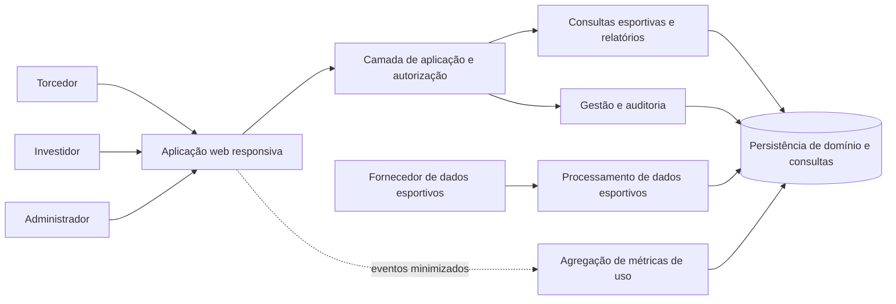

# Fut Fanatics — Arquitetura

**Status:** Arquitetura lógica com implementação inicial em andamento

**Atualizado em:** 2026-10-19

**Escopo:** MVP do Brasileirão Série A de 2026; Node.js nativo e EJS no primeiro corte; fornecedor de dados a definir

## Objetivo e referências

Este documento descreve os limites, responsabilidades e fluxos lógicos do produto. A primeira implementação usa Node.js com o módulo HTTP nativo e renderização SSR por EJS, sem framework web. Banco de dados, provedor de hospedagem, mecanismo de autenticação e fornecedor esportivo continuam pendentes; essas decisões dependem de requisitos de operação, custo, direitos de uso e capacidade da equipe.

As decisões funcionais de referência estão na [visão geral](./visao-geral.md), nas [proto-personas](./personas.md), nas [jornadas e requisitos funcionais](./jornadas-e-requisitos-funcionais.md) e na [especificação canônica](../stories/FUT-FANATICS-PLATFORM/spec/requirements.json).

## Diretrizes arquiteturais

- Separar a experiência web, as regras de negócio, a persistência e as integrações externas por responsabilidades, sem pressupor que sejam serviços implantados separadamente.
- Aplicar autenticação e autorização no lado servidor em toda operação protegida. A interface pode ocultar ações indisponíveis, mas isso não substitui a validação do servidor.
- Tratar resultados e estatísticas como dados versionados e contextualizados por competição, temporada e horário da atualização.
- Isolar a integração esportiva por um contrato interno, para que a escolha ou substituição de fornecedor não altere as regras de classificação e consulta.
- Separar relatórios esportivos de relatórios de uso e disponibilizar a investidores somente métricas agregadas de uso.
- Priorizar consistência e preservação dos últimos dados válidos sobre a apresentação de dados parciais como se fossem atuais.
- Manter a solução responsiva e acessível, em português do Brasil.

## Visão lógica

O diagrama representa responsabilidades lógicas, não processos ou produtos de infraestrutura. A topologia de implantação e a tecnologia de persistência permanecem em aberto.

## Decisões da primeira implementação

- Servidor HTTP implementado com módulos nativos do Node.js; EJS é a dependência de execução para renderizar HTML no servidor.
- A navegação da primeira fatia usa HTML e formulário GET; a folha de estilos é servida pelo próprio servidor.
- Os testes usam o runner nativo `node:test`.
- Os dados atuais são fixtures em memória com clubes fictícios. A interface identifica que são demonstração e que não representam a classificação real de 2026.
- Esta fatia cobre somente a consulta do torcedor. Persistência, autenticação, autorização real, integração esportiva, relatórios de investidor, gestão administrativa e agregação de uso ainda não estão implementados.

As decisões acima descrevem o estado inicial do código, não uma restrição permanente para a arquitetura. A implementação deve continuar modular para permitir persistência e integração substituíveis sem acoplar as regras de domínio à interface ou ao fornecedor.

## Componentes e responsabilidades

| Componente lógico | Responsabilidades |
|---|---|
| Aplicação web responsiva | Apresentar tabela, campanha do time, relatórios e funções administrativas conforme o perfil; manter contexto e filtros visíveis; comunicar carregamento, ausência, desatualização, indisponibilidade e falha. |
| Camada de aplicação e autorização | Receber consultas e comandos, validar identidade e permissões no servidor, validar filtros e dados de entrada e coordenar as regras de domínio. |
| Consultas esportivas | Consultar times, partidas, resultados, estatísticas e classificação da temporada; retornar competição, temporada e atualização junto aos dados. |
| Relatórios | Oferecer consultas separadas para desempenho esportivo e uso do aplicativo. Aplicar filtros permitidos e não expor identificadores pessoais nos relatórios de uso. |
| Processamento de dados esportivos | Receber dados da fonte por mecanismo a definir, normalizar estados e campos, validar registros, detectar partidas encerradas, atualizar os dados válidos e sinalizar falhas para revisão. |
| Gestão administrativa e auditoria | Manter usuários, perfis, permissões, times, temporada, partidas, resultados, estatísticas e configurações; validar comandos e registrar autor, data/hora e ação relevante. |
| Agregação de métricas de uso | Processar eventos minimizados para produzir usuários ativos, sessões e acessos agregados por período. Os relatórios consultáveis não incluem identificadores pessoais. |
| Persistência de domínio e consultas | Manter entidades operacionais, resultados aceitos, estatísticas derivadas, estado de atualização, indicadores agregados e trilha de auditoria. A tecnologia e a estratégia de leitura/escrita serão definidas posteriormente. |

Essas responsabilidades podem ser implementadas inicialmente em uma aplicação modular única ou distribuídas se requisitos operacionais futuros justificarem. A separação lógica não implica adoção de microsserviços.

## Fluxos principais

### Consulta esportiva do torcedor

1. A aplicação web solicita a tabela ou a campanha com a competição, a temporada e, quando selecionado, o time.
2. A camada de aplicação valida os parâmetros e consulta dados da temporada correspondente.
3. As regras de domínio apresentam a classificação derivada de partidas encerradas e aplicam os critérios oficiais de desempate.
4. A resposta inclui o contexto e a atualização dos dados. Quando não houver seleção de time, a consulta retorna a visão geral.
5. Se não houver dados ou os dados estiverem desatualizados ou indisponíveis, a resposta preserva essa condição para a interface não exibir ausência como zero nem resultado pendente como confirmado.

### Relatórios do investidor

1. A camada de aplicação valida no servidor a permissão de acesso aos relatórios.
2. A pessoa escolhe relatório esportivo ou relatório de uso; cada categoria usa consultas e filtros próprios.
3. A consulta esportiva aplica temporada, time e período disponíveis e retorna os indicadores e o contexto usado.
4. A consulta de uso retorna usuários ativos, sessões e acessos agregados por período, sem identificadores pessoais.
5. Filtros inválidos e consultas sem resultados retornam estados explícitos, não valores fabricados.

O escopo padrão proposto para o MVP permite comparação esportiva entre os times da Série A. A eventual restrição por vínculo de investimento ainda precisa ser decidida.

### Atualização esportiva

1. Um mecanismo de integração, a definir, obtém dados da fonte escolhida e os entrega ao processamento esportivo.
2. O processamento mapeia os dados externos para o modelo interno e valida competição, temporada, identificador da partida, participantes, estado e resultado.
3. Uma partida só passa a compor o resultado final quando o encerramento é confirmado pela fonte ou validado por administrador autorizado.
4. A aplicação da atualização é idempotente por partida e temporada: reprocessar a mesma confirmação não cria uma partida duplicada.
5. Resultados aceitos alimentam estatísticas e classificação dependentes. A atualização deve ser consistente para que consultas não misturem o resultado novo com indicadores antigos.
6. Em erro ou dado inválido, o processamento preserva os últimos dados válidos, registra a falha e sinaliza a necessidade de revisão. O horário da última atualização válida continua disponível.

A meta funcional é disponibilizar a atualização em até 15 minutos após a confirmação de encerramento. Ela depende da disponibilidade, latência, contrato e direitos de uso da fonte escolhida.

### Correção administrativa

1. O servidor verifica a permissão administrativa e valida a alteração antes de persistir.
2. Uma alteração rejeitada não modifica o registro e retorna uma explicação que permita a correção.
3. Uma alteração aceita registra ator, data/hora, ação e dados necessários para auditoria, observando a minimização de informações.
4. Correções de resultado ou estatística atualizam os indicadores dependentes sem duplicar a partida.
5. A operação informa sucesso ou falha; uma falha de recálculo deve ser detectável e revisável, sem apresentar indicadores inconsistentes como atualizados.

## Modelo de domínio e consistência

O modelo mínimo acompanha as entidades da especificação:

- Usuário, perfil e permissão.
- Competição, temporada e time participante.
- Partida, estado, resultado e estatísticas recebidas ou corrigidas.
- Tabela e estatísticas esportivas derivadas de partidas encerradas.
- Métricas agregadas de uso por período.
- Eventos de auditoria para ações administrativas relevantes e eventos de operação necessários à revisão.

As partidas são a base dos indicadores esportivos. Estatísticas e classificação devem poder ser recalculadas a partir dos registros aceitos, com regras de desempate oficiais e determinísticas. Cada registro esportivo deve estar associado à competição e à temporada; resultados pendentes, adiados, cancelados ou interrompidos não podem ser tratados como encerramentos definitivos sem confirmação apropriada.

O desenho físico dos dados, a política de retenção, o controle de concorrência e a estratégia de reconstrução de indicadores ainda precisam ser definidos na etapa de desenho técnico.

## Segurança e privacidade

- Verificar autenticação e autorização no servidor para cada consulta ou comando protegido, negando operações não autorizadas sem revelar dados protegidos.
- Aplicar permissões por perfil para torcedor, investidor e administrador; permissões administrativas devem ser verificadas individualmente nas operações de gestão.
- Manter separados os conjuntos de consulta esportiva, agregados de uso e auditoria, ainda que compartilhem uma tecnologia de persistência.
- Não incluir identificadores pessoais de torcedores na saída dos relatórios de uso. Definir antes da implementação quais eventos mínimos são necessários para calcular métricas agregadas e como serão protegidos e retidos.
- Registrar ações administrativas com autor e data/hora, limitando o conteúdo de auditoria aos dados necessários à rastreabilidade.
- Projetar o tratamento de dados pessoais em conformidade com a LGPD e com requisitos de acesso, retenção e descarte a serem definidos.

## Qualidade e operação

| Requisito | Implicação arquitetural |
|---|---|
| Responsividade e português do Brasil (NFR-1) | A interface e os contratos de consulta devem servir os mesmos fluxos em celular, tablet e desktop e preservar rótulos e formatos localizados. |
| Consultas em até 3 segundos para 95% das requisições (NFR-2) | Medir latência de tabela e relatórios sob uma carga de referência, a definir. Modelar consultas para evitar recálculos completos a cada leitura; definir cache ou projeções somente após medição. |
| Atualização em até 15 minutos e consistência em falhas (NFR-3) | Medir o atraso entre confirmação da fonte e publicação; monitorar falhas; preservar o último dado válido; garantir processamento repetível e recuperação de indicadores. |
| Autorização e proteção de dados (NFR-4) | Centralizar a decisão de autorização no servidor, testar negações de acesso e impedir dados identificáveis nas respostas de relatórios de uso. |
| Acessibilidade WCAG 2.2 AA (NFR-5) | Incluir acessibilidade nos componentes e fluxos de interface e verificar por testes automatizados e revisão manual. |

O painel operacional deve permitir identificar a atualidade dos dados esportivos, falhas de integração e atualizações que exigem revisão. Logs e métricas operacionais devem apoiar diagnóstico sem registrar segredos ou dados pessoais desnecessários.

## Decisões pendentes

- Fornecedor, contrato e método de integração dos dados esportivos, incluindo cobertura, precisão, latência, direitos de uso e custo.
- Mecanismo de autenticação, ciclo de vida de contas e origem da atribuição de perfis.
- Tecnologias de persistência, processamento e hospedagem, além das escolhidas para a primeira fatia.
- Carga de referência, escalabilidade, disponibilidade, backup, recuperação e objetivos de continuidade.
- Método de cálculo de usuários ativos, sessões e acessos, além de retenção e controles dos eventos de uso.
- Se o acesso aos relatórios esportivos será limitado ao time relacionado a cada investidor.
- Política de retenção da auditoria, trilhas operacionais e dados pessoais.

## Rastreabilidade

| Área arquitetural | Requisitos relacionados |
|---|---|
| Perfis, autorização e gestão | FR-1, FR-2, NFR-4 |
| Competição, partidas, tabela e campanha do time | FR-3 a FR-6 |
| Relatórios esportivos e filtros | FR-7, FR-9 |
| Relatórios agregados de uso | FR-8, NFR-4 |
| Atualidade, validação, correção e consistência | FR-4, FR-10 a FR-12, NFR-3 |
| Experiência responsiva, desempenho e acessibilidade | NFR-1, NFR-2, NFR-5 |